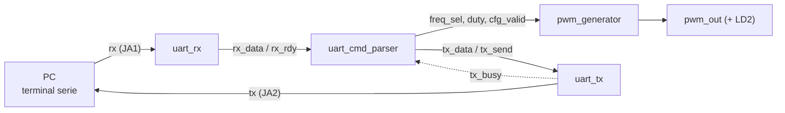

# CLP_PWM_ESPINOLA_SOTTILE
Trabajo final Circuitos Lógicos Programables - PWM Configurable por UART - 

# Generador PWM configurable por UART

Implementación en **VHDL** de un generador PWM cuya frecuencia y ciclo de trabajo (duty cycle) se configuran desde una PC mediante comandos de texto enviados por UART. La FPGA responde `OK` o `ERR` a cada comando. Está implementado sobre la placa **Arty Z7-10 (Zynq-7000)** con **Vivado 2018.3**.

Trabajo práctico final de **Circuitos Lógicos Programables** (Especialización en Sistemas Embebidos).

Autores: Espinola Maximiliano, Sottile Victoria.

Video demostrativo: https://youtu.be/AbcuTCT8Qqc 

## Características

- Tres frecuencias seleccionables: **1 kHz, 10 kHz y 100 kHz**.
- Duty cycle configurable de **0 a 100 %** en pasos de 1 %.
- UART a **115200 baudios, 8N1**, con respuesta de confirmación (`OK` / `ERR`).
- Reloj único de **125 MHz** (timing cerrado, WNS de +1,250 ns).
- Depuración en placa con **ILA** y **VIO** de Vivado.

## Cómo funciona

Desde una terminal serie se envía un comando, por ejemplo `F2` o `D75`. El receptor UART lo convierte en bytes, el parser lo interpreta y actualiza la configuración, y el generador PWM la aplica. En paralelo, el parser arma la respuesta y la envía a la PC por el transmisor UART.



| Módulo | Archivo | Función |
|---|---|---|
| `uart_rx` | `src/uart_rx.vhd` | Receptor serie: sincronizador de 2 flip-flops y muestreo al centro de cada bit. Entrega un byte con un pulso `data_rdy`. |
| `uart_tx` | `src/uart_tx.vhd` | Transmisor serie. La señal `busy` indica que está ocupado. |
| `uart_cmd_parser` | `src/uart_cmd_parser.vhd` | Máquina de estados que interpreta los comandos, actualiza `freq_sel` y `duty_cycle`, emite `cfg_valid` (pulso de 1 ciclo) y genera la respuesta. |
| `pwm_generator` | `src/pwm_generator.vhd` | Contador contra umbral: la salida vale 1 mientras `counter < threshold`. El umbral se calcula sin divisor y está registrado. |
| `pwm_top` | `src/pwm_top.vhd` | Top level: reloj global (BUFG), reset sincronizado, instancias de los módulos y LEDs. |
| `pwm_top_vio` | `src/pwm_top_vio.vhd` | Igual que `pwm_top`, con un VIO para el reset virtual y para monitorear los LEDs (requiere el IP `vio_0`). |

## Protocolo de comandos

Texto ASCII en mayúsculas, terminado en CR o LF.

| Comando | Efecto | Respuesta |
|---|---|---|
| `F1` | Frecuencia de 1 kHz | `OK` |
| `F2` | Frecuencia de 10 kHz | `OK` |
| `F3` | Frecuencia de 100 kHz | `OK` |
| `D<NN>` (por ejemplo `D75`) | Duty cycle de 0 a 100 %, hasta 3 dígitos | `OK` |
| Cualquier otro comando o un valor mayor que 100 | Sin cambios | `ERR` |

Las respuestas terminan en `\r\n`. Al arrancar o después de un reset, el sistema queda en **1 kHz con 50 %**.

Ejemplo de sesión:

```
F2   -> OK     (10 kHz)
D25  -> OK     (duty 25 %)
D75  -> OK     (duty 75 %)
D150 -> ERR    (fuera de rango, se mantiene 75 %)
```

## Hardware

- Placa: **Arty Z7-10** (Zynq-7000, XC7Z010).
- Herramienta: **Vivado 2018.3**.
- Un adaptador **USB-TTL de 3,3 V** para la UART.

| Señal | Pin | Función |
|---|---|---|
| `clk_125mhz` | H16 | Reloj de 125 MHz |
| `rst_btn` | D19 | BTN0, reset activo en alto |
| `uart_rx` | Y18 | Pmod JA1: entrada desde el TX del adaptador |
| `uart_tx` | Y19 | Pmod JA2: salida hacia el RX del adaptador |
| `pwm_out` | W14 | Salida PWM |
| `led[0]`, `led[1]` | R14, P14 | LD0 y LD1: bits de `freq_sel` |
| `led[2]` | N16 | LD2: réplica de la salida PWM |

Todas las señales usan LVCMOS33. Conexión de la UART: TX del adaptador a JA1, RX del adaptador a JA2 y masas unidas.


